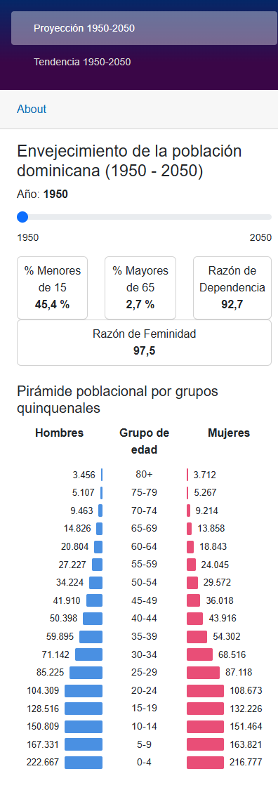
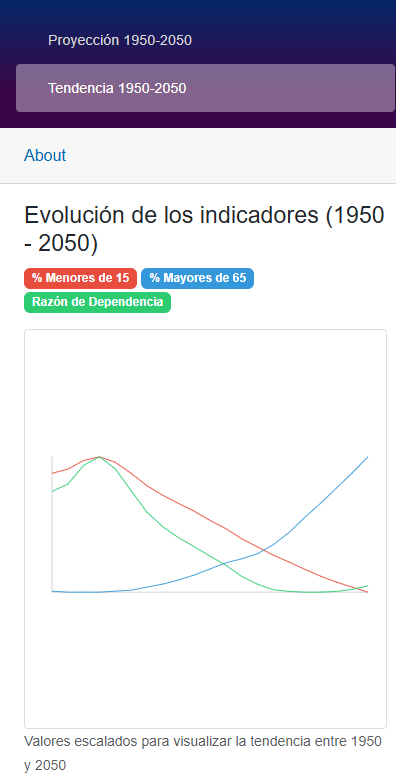

# Envejecimiento de la población dominicana, 1950–2050

Dashboard full-stack que visualiza la evolución demográfica de República Dominicana:
**pirámide poblacional animada**, **indicadores socio-demográficos** por año y **gráfica de tendencia** 1950–2050.

Los datos son estimaciones y proyecciones de la **Oficina Nacional de Estadística (ONE)**, publicadas como dato abierto bajo licencia **ODbL** — se requiere atribución:
[Estimaciones y proyecciones de la población total según sexo y grupos quinquenales de edad, 1950-2050](https://datos.gob.do/dataset/estimaciones-y-proyecciones-de-la-poblacion-total-segun-sexo-y-grupos-quinquenales-de-edad-1950-2050).

> Nota: el corte entre estimación y proyección se ubica en 2020. Es una **inferencia** a partir de la fecha de creación del dataset (diciembre 2020), no un hecho verificado en una nota metodológica.

## Capturas

### Pirámide poblacional e indicadores



### Tendencia 1950–2050



## Arquitectura

```
src/
├── Domain/          Records del dominio + ServicioIndicadores (LINQ puro, sin dependencias)
├── Infrastructure/  EF Core: DbContext, migración, lector CSV e importador
├── Api/             Minimal API: expone indicadores, filas e importación
└── Blazor/          UI interactiva (Server): slider, pirámide, tarjetas y gráfica SVG
scripts/
└── limpiar_datos.py ETL en Python/pandas: raw (latin-1, ';') → data/limpio.csv
data/
├── data_set.csv     Fuente original ONE (no modificar)
└── limpio.csv       1.071 filas: edad, sexo, poblacion, anio, edad_min
tests/
└── Domain.Tests/    xUnit: 3 años de referencia validados contra ONE
```

**Regla de dependencias:** `Infrastructure → Domain` y `Api/Blazor → Domain`. Domain no conoce ni EF Core, ni SQLite, ni la API.

## Cómo arrancar

Requisito: **.NET 10 SDK** (`dotnet --version` → `10.0.402` o superior). Visual Studio 2022 no soporta .NET 10; usa VS 2026 (v18) o la CLI.

### 1. Restaurar, compilar y probar

```bash
dotnet restore
dotnet build
dotnet test
```

`dotnet test` debe terminar con **3 pruebas correctas, 0 con error** (1950, 2035, 2050).

### 2. Base de datos (solo la primera vez)

```bash
dotnet ef database update --project src/Infrastructure --startup-project src/Infrastructure
```

La base se crea en `data/proyeccion2050.db` y **no se commitea** (se regenera con migración + importador).

### 3. Levantar la API (terminal 1)

```bash
dotnet run --project src/Api --urls "http://localhost:5024"
```

Importar el CSV (una vez; el importador es idempotente):

```bash
Invoke-RestMethod -Method Post -Uri http://localhost:5024/importar -ContentType "application/json" -Body '{}'
# → filasImportadas: 1071
```

### 4. Levantar la UI (terminal 2)

```bash
dotnet run --project src/Blazor --urls "http://localhost:5180"
```

Abrir **http://localhost:5180/proyeccion** y **http://localhost:5180/tendencia**.

> ⚠️ Blazor y API son **dos procesos independientes**. Si la API no está corriendo, la UI falla con `SocketException 10061` al intentar cargar los datos.

## Endpoints de la API

| Método | Ruta | Descripción |
|---|---|---|
| `GET` | `/poblacion` | Las 1.071 filas leídas directamente del CSV |
| `GET` | `/poblacion/db` | Las filas leídas desde SQLite (EF Core) |
| `GET` | `/indicadores/{anio}` | Los 4 indicadores de un año (reutiliza `ServicioIndicadores`) |
| `GET` | `/indicadores/serie` | Los 21 años de referencia, 1950–2050 |
| `POST` | `/importar` | Importa `limpio.csv` a SQLite; devuelve el conteo |

## Indicadores

| Indicador | Cálculo |
|---|---|
| `% Menores de 15` | `población < 15 / total × 100` |
| `% Mayores de 65` | `población ≥ 65 / total × 100` |
| Razón de feminidad | `mujeres / hombres × 100` |
| Razón de dependencia | `(< 15 + ≥ 65) / (15–64) × 100` |

Ejemplo verificado (1950): **45.4 / 2.7 / 97.5 / 92.7**. Todos los valores se redondean a 1 decimal con `Math.Round`.

## Decisiones y tradeoffs

- **EF Core + SQLite:** se usa con fines **didácticos** para practicar Code First, migraciones, DbContext e importación. Con 1.071 filas, un archivo plano habría sido suficiente.
- **`decimal` (no `double`):** base 10, 28–29 dígitos; permite comparaciones exactas en los tests.
- **`enum Sexo` en vez de string:** el compilador protege los valores; el coste es la frontera de traducción (`switch` en el lector y en los tests).
- **Llave primaria compuesta** `(Sexo, EdadMin, Anio)`: el record de dominio no tiene `Id`; es la clave natural del dataset.
- **Fecha de corte, suposición documentada:** ver nota sobre 2020 arriba.
- **Validación pendiente en el ETL:** `scripts/limpiar_datos.py` calcula el residuo de la validación H+M=Ambos pero **no bloquea** la escritura del CSV (deuda conocida).

## Estado

- ✅ Etapa 0–4: datos, dominio + tests, persistencia + API, UI con pirámide y tendencia
- 🔲 Etapa 5: pulido de UI (ejes con valores, limpieza de páginas plantilla, CORS)
- 🔲 Etapa 6: Dockerfile multi-stage, docker-compose y GitHub Actions (build + test en cada push)
